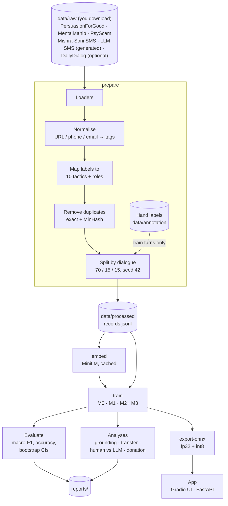
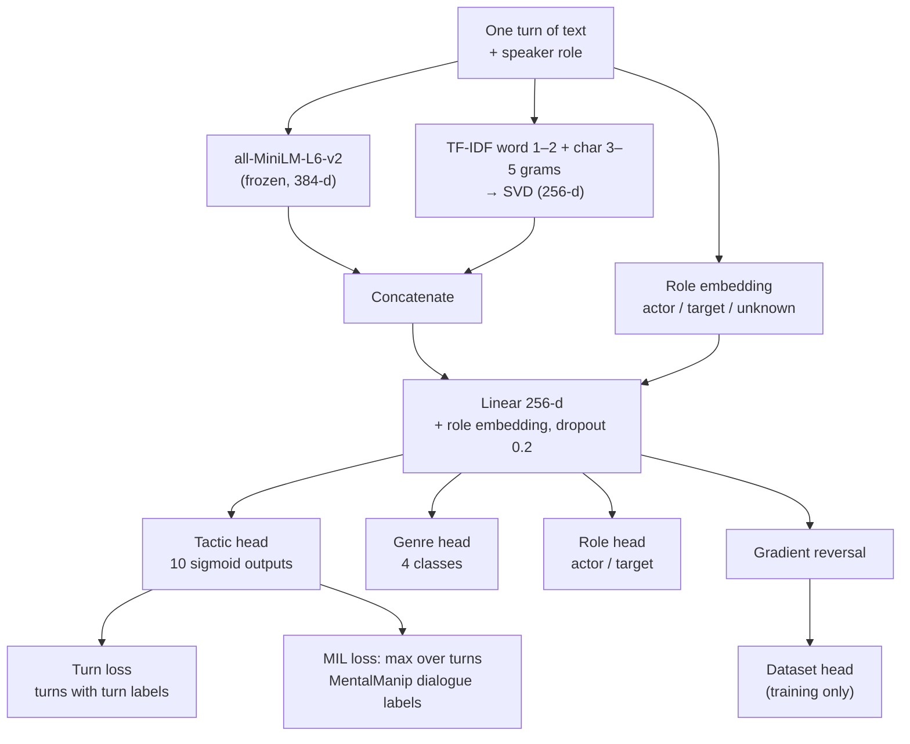
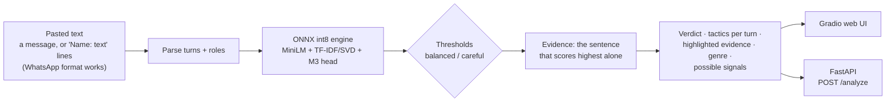

# TacticLens

**Where Persuasion Ends and Manipulation Begins: A Unified, Role-Aware Model of Influence Tactics
Across Persuasive Dialogue, Interpersonal Manipulation and Human- vs LLM-Written Scams.**

TacticLens finds influence tactics in a message or a conversation, turn by turn: legitimate appeals
(reasons, sympathy, credibility, personal stories), pressure (urgency, rewards, flattery) and
manipulation (guilt, threats, distortion and blame). For each tactic it shows the sentence the
decision rests on. Everything trains and runs on a laptop CPU, at zero cost.

## Results at a glance

Final model `m3_no-context_ev`, test split, mean over 3 seeds where shown.

| What | Score |
|---|---|
| Tactic detection, single turns (macro-F1) | 0.586 ± 0.007 (best baseline 0.585, M0 strict) |
| Tactic detection, whole conversations (macro-F1) | 0.356 ± 0.017 (best baseline 0.304, M0) |
| SMS: scam or not (accuracy) | 97.1% (F1 93.8%) |
| Single turns: uses any tactic (accuracy) | 85.3% (F1 82.7%) |
| Grounding: score drop when the evidence is deleted | 0.221 (random words deleted: 0.016) |
| App model size and speed | 23 MB int8 ONNX, about 100 ms per turn on CPU |

## Taxonomy

| Group | Tactics |
|---|---|
| Legitimate | T1 Rational appeal · T2 Emotional appeal (sympathy) · T3 Credibility / authority · T4 Personal story |
| Pressure | T5 Urgency / scarcity · T6 Reward / reciprocity · T7 Flattery / liking |
| Manipulative | T8 Guilt / obligation · T9 Threat / intimidation · T10 Distortion and blame |

Every source dataset's labels are mapped onto these ten (`configs/taxonomy.yaml`). Each turn also has
a speaker role (actor or target) and a genre (persuasion, manipulation, scam, neutral).

## Architecture

### End-to-end pipeline



### The model (M3, final variant)



- **Turn loss:** binary cross-entropy on turns that have their own tactic labels (PersuasionForGood,
  PsyScam, and evidence spans added as extra training turns).
- **Multiple-instance (MIL) loss:** MentalManip only says which tactics a *conversation* uses. The
  conversation's score is the maximum over its turns, so the model learns guilt and distortion
  without any per-turn labels for them.
- **Gradient reversal:** discourages the shared layer from encoding which dataset a turn came from.
- **Thresholds:** one per tactic, tuned on validation separately for turns and conversations.
  "Balanced" thresholds maximise F1; "careful" thresholds maximise accuracy (fewer false alarms).

### The app



## Repository layout

```
TacticLens/
  configs/
    taxonomy.yaml        10 tactics and how each dataset's labels map onto them
    datasets.yaml        where each dataset lives and which columns to read
    lexicon.yaml         cue words used by M1 and the human vs LLM check
    m3_best.json         M3 settings chosen on validation data
  data/
    raw/                 downloaded datasets (not in Git)
    processed/           unified records with splits (created by `prepare`)
    annotation/          hand-labelling files (check set, extra batches)
  docs/
    annotation_guide.md  how to label tactics by hand
    user_study.md        protocol for the app's user study
  src/tacticlens/
    data/                loaders, normalising, duplicate removal, splits, LLM SMS generator
    taxonomy/            label mapping, roles, check set, kappa, hand labels
    features/            hand-made lexicon features (M1)
    models/              M0–M3, shared training and evaluation code
    eval/                metrics, bootstrap confidence intervals, model comparison
    analysis/            grounding, transfer, human vs LLM, donation, hand-label check
    serve/               ONNX export, inference engine, web UI, API, Space bundle
    cli.py               one entry point for every step
  tests/                 unit tests on small synthetic data
  models/, reports/      trained models and result reports (created when you run)
  Dockerfile             runs the app or the API in a container
```

## Setup (Windows, once)

Python 3.10 or 3.11. In a terminal in this folder:

```cmd
python -m venv .venv
.venv\Scripts\activate
pip install -r requirements.txt -r requirements-ml.txt -r requirements-app.txt
pip install -e .
pytest -q
```

All tests should pass before you add data. On macOS or Linux, activate with
`source .venv/bin/activate`.

## Data

Put each dataset in its own folder. File names don't matter much: the loaders find the right file,
and `configs/datasets.yaml` can override them. Data is not included in this repository.

| Dataset | Folder | Source | Licence |
|---|---|---|---|
| PersuasionForGood | `data/raw/p4g/` | [gitlab.com/ucdavisnlp/persuasionforgood](https://gitlab.com/ucdavisnlp/persuasionforgood) | see source |
| MentalManip | `data/raw/mentalmanip/` | [github.com/audreycs/MentalManip](https://github.com/audreycs/MentalManip) | CC BY-NC 4.0 |
| PsyScam | `data/raw/psyscam/` | link in the paper, [arXiv 2505.15017](https://arxiv.org/abs/2505.15017) | research use |
| Mishra-Soni SMS | `data/raw/sms_human/` | [Mendeley Data f45bkkt8pr](https://data.mendeley.com/datasets/f45bkkt8pr/1) | CC BY 4.0 |
| LLM-written SMS | `data/raw/sms_llm_gen/` | generated locally (below) | MIT |
| DailyDialog (optional) | `data/raw/dailydialog/` | [Hugging Face](https://huggingface.co/datasets/li2017dailydialog/daily_dialog) | CC BY-NC-SA 4.0 |

The LLM-written SMS are generated with [Ollama](https://ollama.com) on the laptop. Prompts give only a
topic and a sender, never a tactic. The set used in this project:

```cmd
ollama pull qwen2.5:3b
python -m tacticlens.cli gen-llm-sms --models qwen2.5:3b --smishing 500 --spam 150 --ham 350
```

DailyDialog adds everyday conversation as "no tactic" examples, which cuts false alarms on ordinary
chat. Only its train and validation dialogues are used for training; its test dialogues are kept for
the `everyday` check.

Check what the loaders find with `python -m tacticlens.cli inspect`.

## Run the pipeline

```cmd
:: 1. Data
python -m tacticlens.cli prepare                  :: load, normalise, map labels, dedupe, split
python -m tacticlens.cli datacard                 :: reports/data_card.md
python -m tacticlens.cli embed                    :: MiniLM embeddings, cached (10-20 min, once)

:: 2. Models (results in reports/<model>_results.md)
python -m tacticlens.cli train m0                 :: TF-IDF + logistic regression
python -m tacticlens.cli train m1                 :: lexicon features + XGBoost
python -m tacticlens.cli train m2                 :: MiniLM + MLP
python -m tacticlens.cli train m3 --variant no-context --evidence-aug    :: final model

:: 3. Analyses (reports/)
python -m tacticlens.cli grounding m0 m3_no-context_ev    :: does the score depend on the evidence?
python -m tacticlens.cli transfer                         :: train on two genres, test on the third
python -m tacticlens.cli human-vs-llm                     :: tactics in human vs LLM smishing
python -m tacticlens.cli donation                         :: tactics vs donations (PersuasionForGood)

:: 4. App
python -m tacticlens.cli export-onnx              :: models/onnx (fp32 + int8)
python -m tacticlens.cli eval-onnx                :: reports/onnx.md: F1, size, speed
python -m tacticlens.cli ui                       :: web UI at http://127.0.0.1:7860
python -m tacticlens.cli serve                    :: API at http://127.0.0.1:8000/docs
```

Try one message from the command line:

```cmd
python -m tacticlens.cli analyze "URGENT: your account is locked, verify now at http://x.example"
```

### Reproducing the experiments

| Experiment | Command |
|---|---|
| Choose M3 settings on validation data | `python -m tacticlens.cli sweep-m3` |
| Ablations | `train m3 --variant full`, `no-role`, `no-adv`, `no-mil`, `dual-role` |
| Other seeds | add `--seed 1`, `--seed 2` (saved as `<model>_s1`, ...) |
| Mean ± SD over seeds | `python -m tacticlens.cli summarize` → `reports/summary.md` |
| Is model A better than B? | `python -m tacticlens.cli compare m0 m3_no-context_ev` (paired bootstrap) |
| Re-tune thresholds without retraining | `python -m tacticlens.cli rescore` |
| False alarms on everyday chat | `python -m tacticlens.cli everyday` (needs DailyDialog) |

## Hand labels

Two people label the same 300 turns to measure agreement and to check the dataset labels and the
model. Rules and practice items: [`docs/annotation_guide.md`](docs/annotation_guide.md).

```cmd
python -m tacticlens.cli checkset         :: export checkset_A.csv and checkset_B.csv (done once)
python -m tacticlens.cli kappa            :: agreement per tactic (Cohen's kappa)
python -m tacticlens.cli agree            :: merge both files; "?" marks disagreements to settle
python -m tacticlens.cli manual-eval      :: dataset labels and model against the hand labels
python -m tacticlens.cli label-batch      :: optional: more turns to label for training
```

Hand labels never change the original dataset files. Check-set items come from validation and test
data and are used only to evaluate.

## Docker

```cmd
python -m tacticlens.cli export-onnx
python -m tacticlens.cli bundle-space
docker build -t tacticlens .
docker run -p 7860:7860 tacticlens
```

## Limits

- English only. Hinglish and other languages are not supported yet.
- Detecting manipulation across a whole conversation is the weakest part (macro-F1 0.356).
- Tactics learned in one genre transfer poorly to another.
- Results are model outputs, not proof of anyone's intent.

## Licence

Code: MIT (see `LICENSE`). Data is not included. Because MentalManip is CC BY-NC 4.0, trained models
are for non-commercial research use only.
